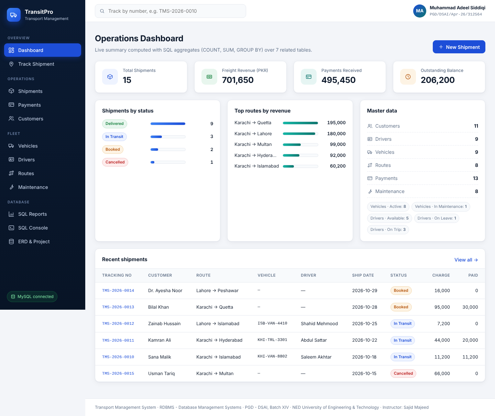
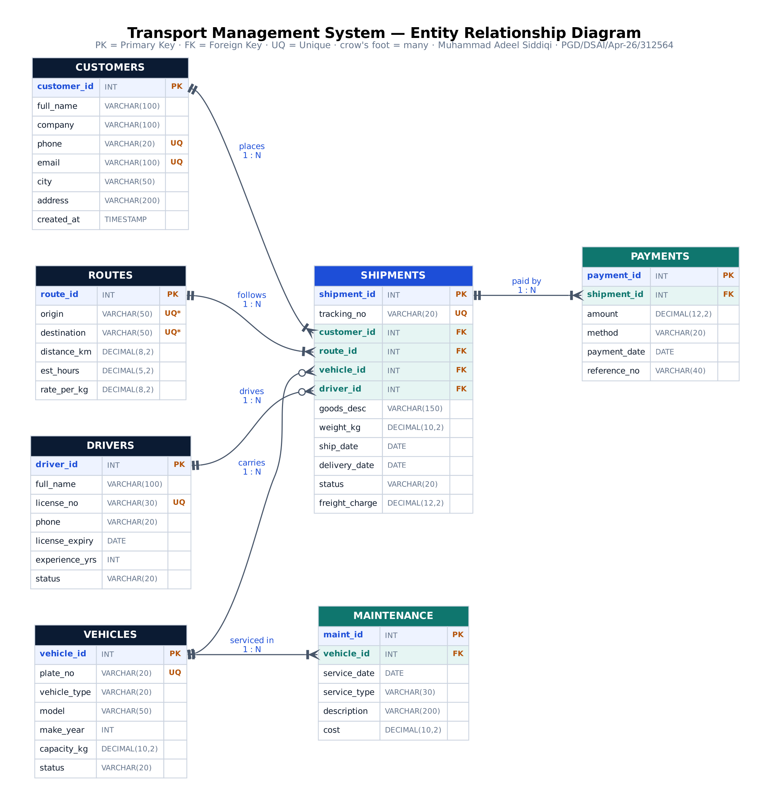
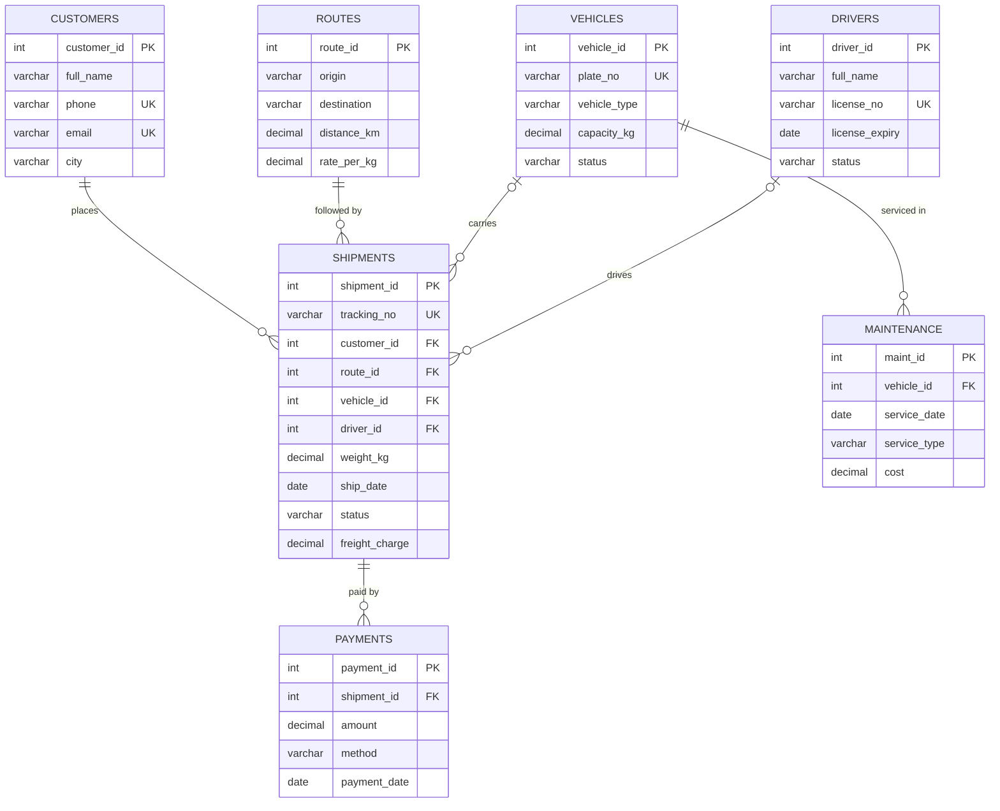
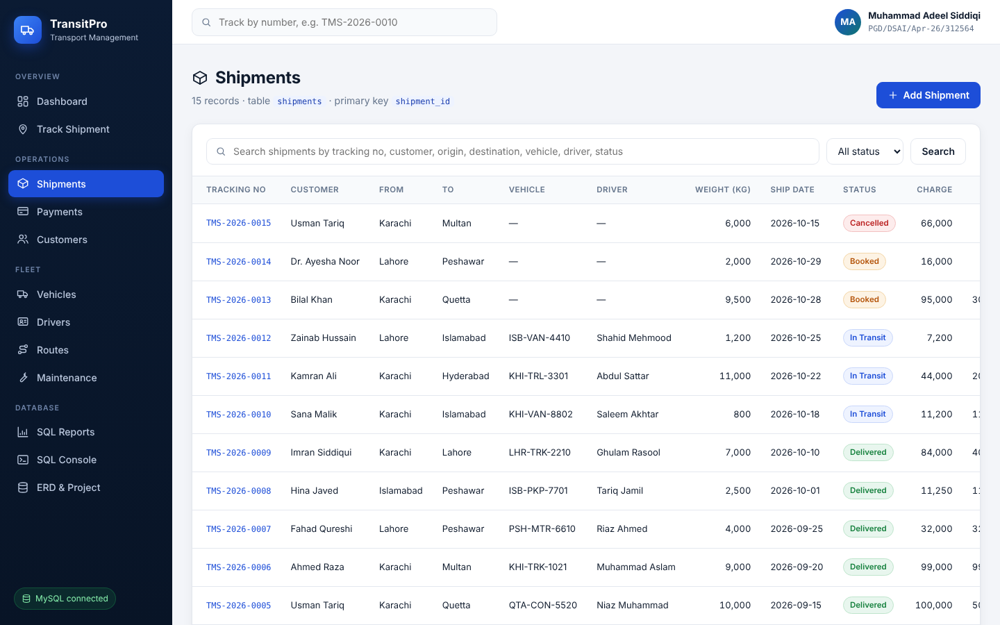
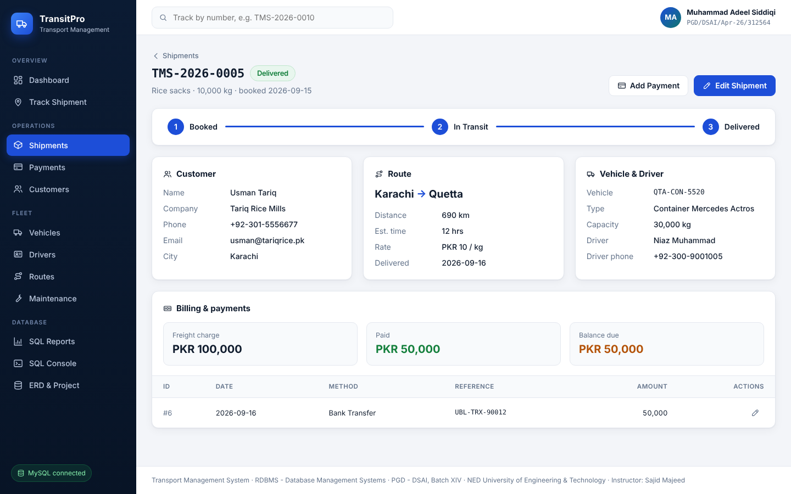
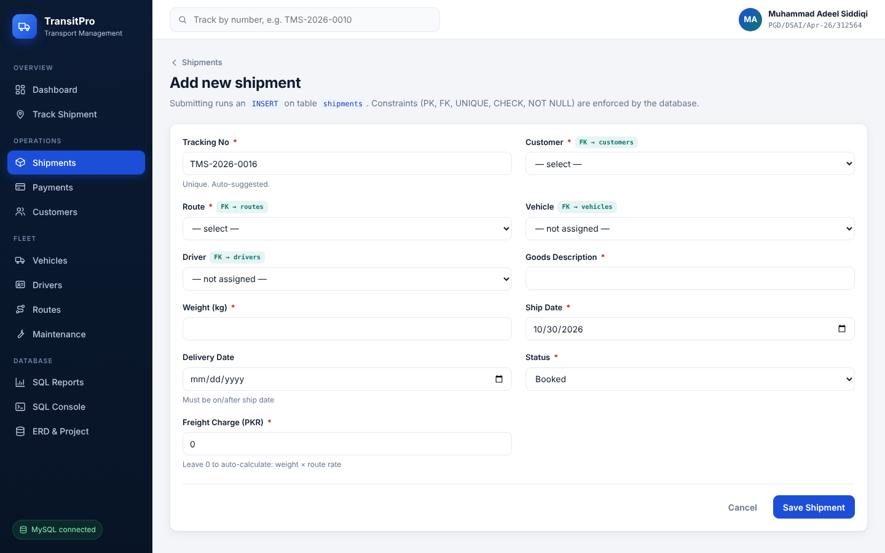
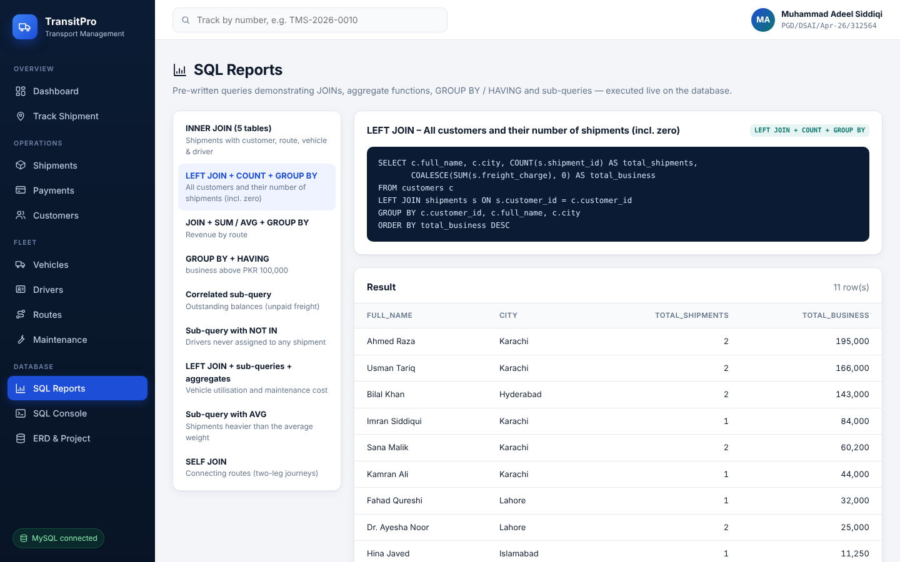
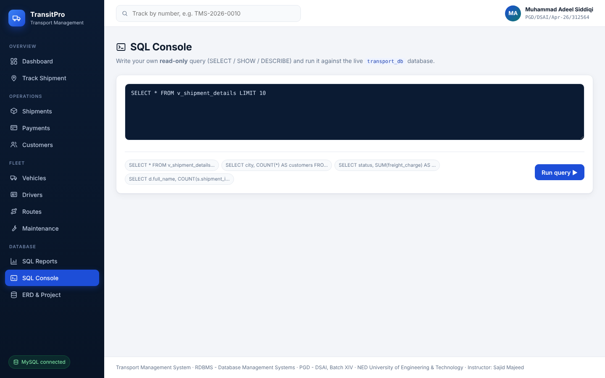
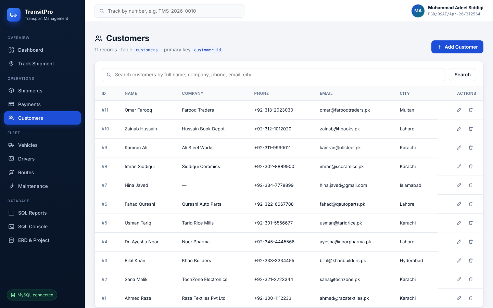
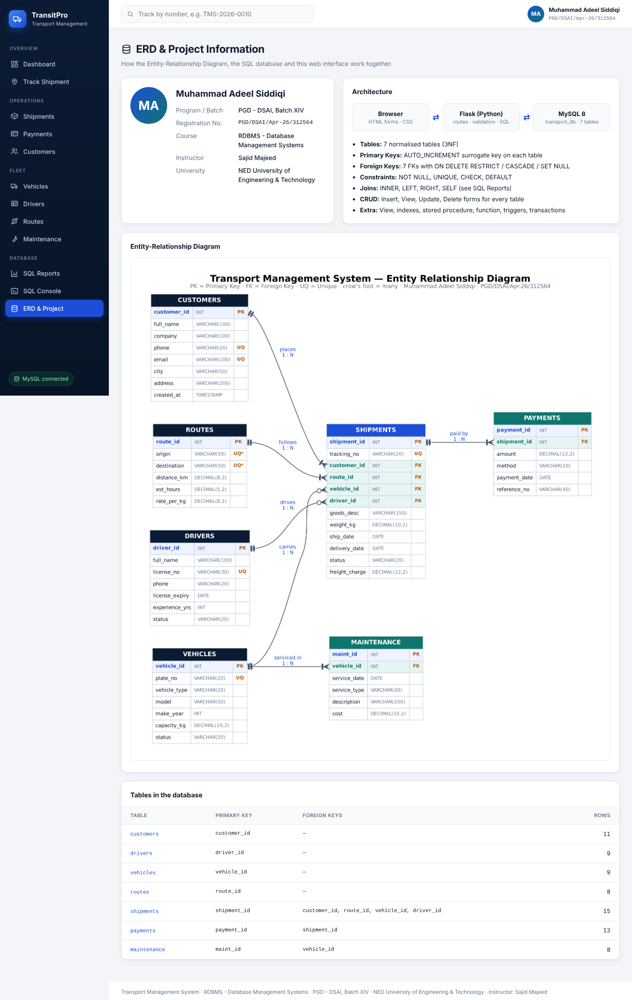

<div align="center">

# 🚚 TransitPro – Transport Management System

**A web-based database application: ERD → MySQL relational database → Flask web interface**




</div>

## 👤 Project information

| | |
|---|---|
| **Student** | Muhammad Adeel Siddiqi |
| **Program / Batch** | PGD – DSAI, Batch XIV |
| **Registration No.** | PGD/DSAI/Apr-26/312564 |
| **Course** | RDBMS – Database Management Systems |
| **Instructor** | Sajid Majeed |
| **University** | NED University of Engineering & Technology |

## ✨ Highlights

- **7 tables** in 3NF, designed from an **ERD**, with **6 foreign keys**, **19 CHECK** and **6 UNIQUE** constraints
- **Full CRUD** web forms for every table, plus search, filters and shipment tracking
- **Live dashboard** and **9 SQL reports** (INNER / LEFT / SELF JOIN, GROUP BY, HAVING, sub-queries)
- **One-click start** on Windows: the MySQL database builds itself on the first run
- **SQL made visible:** every save shows the SQL statement that ran, and constraint errors are explained clearly
- Parameterised queries (no SQL injection) and transactions (COMMIT / ROLLBACK)

## 📂 Project documents

| Document | What it contains |
|---|---|
| 📊 [**Presentation** (PowerPoint)](documents/TransitPro_Presentation.pptx) | 16 slides: the whole project in pictures, from ERD to app tour |
| 📄 [**Overview** (PDF, 1 page)](documents/TransitPro_Overview.pdf) | One-page visual summary of the app |
| 📘 [**App Guide** (PDF, 4 pages)](documents/TransitPro_App_Guide.pdf) | How to run and evaluate the project in about 5 minutes |
| 📗 [**User Manual** (Word, 16 pages)](documents/TransitPro_User_Manual.docx) | How to use every screen, with field reference tables |
| 🗺️ [**ERD**](docs/ERD.png) | Entity Relationship Diagram (also drawn below in Mermaid) |

## ⚡ Quick start (Windows, 3 steps)

| Step | Do this |
|---|---|
| **1** | Click the green **Code** button → **Download ZIP** (or `git clone https://github.com/madeelsiddiqui-ctrl/TransitPro-TMS.git`), then extract it. Install **Python 3.10+** from python.org and tick **"Add python.exe to PATH"**. |
| **2** | Double-click **`START_HERE.bat`**. Type your **MySQL root password** (the one you use in MySQL Workbench) and press **Enter**. |
| **3** | The browser opens **http://127.0.0.1:5000**. In MySQL Workbench, refresh *Schemas*: **`transport_db`** appears with all 7 tables. |

`START_HERE.bat` installs the packages, creates the MySQL database on the first run and opens the dashboard. No MySQL? Just press Enter: the app runs on a built-in SQLite copy of the same database.

**macOS / Linux:**
```bash
pip install -r requirements.txt
export MYSQL_PASSWORD=your_password     # or: export DB_ENGINE=sqlite
python3 app.py                          # then open http://127.0.0.1:5000
```

---

## Table of Contents
1. [Project Overview](#1-project-overview)
2. [Features](#2-features)
3. [Technology Stack](#3-technology-stack)
4. [Folder Structure](#4-folder-structure)
5. [Entity Relationship Diagram (ERD)](#5-entity-relationship-diagram-erd)
6. [Database Design – Tables & Data Dictionary](#6-database-design--tables--data-dictionary)
7. [SQL Concepts Covered](#7-sql-concepts-covered)
8. [How to Run – Option A: MySQL + MySQL Workbench (recommended)](#8-how-to-run--option-a-mysql--mysql-workbench-recommended)
9. [How to Run – Option B: SQLite (zero setup)](#9-how-to-run--option-b-sqlite-zero-setup)
10. [How to Run on the Web (online hosting)](#10-how-to-run-on-the-web-online-hosting)
11. [Using the Application (User Guide)](#11-using-the-application-user-guide)
12. [How ERD, SQL and Web Interface Work Together](#12-how-erd-sql-and-web-interface-work-together)
13. [Testing Constraints (Demo Script for Viva)](#13-testing-constraints-demo-script-for-viva)
14. [Screenshots](#14-screenshots)
15. [Troubleshooting](#15-troubleshooting)
16. [Conclusion](#16-conclusion)

---

## 1. Project Overview

A transport / logistics company needs to manage **customers** who book **shipments**, the **routes** those shipments travel on, the **vehicles** and **drivers** assigned to them, the **payments** received against each shipment, and the **maintenance** history of the fleet.

This project designs that business as an **Entity Relationship Diagram**, converts the ERD into a **normalised relational database (MySQL)** with primary keys, foreign keys and constraints, and provides a **professional web interface** (Python Flask) where users can **insert, view, search, update and delete** records. Every page shows which SQL is being executed, so the link between the web interface and the database is clearly visible.

**Objective (as per assignment):** demonstrate how an ERD, an SQL database and a web interface work together in one functional application.

---

## 2. Features

| Area | What it does |
|---|---|
| **Dashboard** | KPIs (total shipments, revenue, payments received, outstanding balance), shipments by status, top routes by revenue, fleet & driver status, recent shipments – all computed with SQL `COUNT`, `SUM`, `GROUP BY`, `JOIN`. |
| **CRUD for 7 tables** | Add / View / Search / Edit / Delete forms for Customers, Drivers, Vehicles, Routes, Shipments, Payments and Maintenance. |
| **Search & filter** | Keyword search (`LIKE`) on every list page, status filter on shipments. |
| **Foreign-key dropdowns** | Forms show related records (e.g. choose a Customer, Route, Vehicle, Driver for a shipment) – the selected ID is stored as a foreign key. |
| **Shipment detail page** | 5-table JOIN showing customer, route, vehicle, driver, progress tracker, payments and balance due. |
| **Shipment tracking** | Look up any shipment by its tracking number (e.g. `TMS-2026-0010`). |
| **Business rules** | Freight auto-calculated (`weight × route rate`) when left 0; delivery date auto-filled when status = Delivered; over-capacity warning. |
| **Constraint feedback** | When a PK / FK / UNIQUE / CHECK / NOT NULL constraint fails, the database error is caught and a clear message is shown. |
| **SQL Reports** | 9 ready queries: INNER JOIN, LEFT JOIN, SELF JOIN, GROUP BY + HAVING, correlated sub-query, NOT IN, aggregates – with the SQL text and live result. |
| **SQL Console** | Type any read-only `SELECT` query and run it against the live database. |
| **ERD & Project page** | Student profile, architecture, ERD image and table summary. |
| **Two database engines** | MySQL (for Workbench demo) or SQLite (runs anywhere with no installation) – same SQL, same app. |
| **Responsive UI** | Works on desktop, tablet and mobile. |

---

## 3. Technology Stack

| Layer | Technology |
|---|---|
| Database | **MySQL 8.x** (managed with **MySQL Workbench**) · SQLite 3 as an optional fallback |
| Backend | **Python 3.10+**, **Flask 3** (web framework), **PyMySQL** (MySQL driver) |
| Frontend | HTML5 (Jinja2 templates), CSS3 (custom responsive design), no external JS framework |
| Diagram | Graphviz (ERD), MySQL Workbench Reverse-Engineer (alternative ERD) |

---

## 4. Folder Structure

```
TransitPro-TMS/
│
├── app.py                   # Flask application: routes, CRUD, reports, business rules
├── db.py                    # Database connectivity layer (MySQL / SQLite), error handling
├── config.py                # Database settings (host, user, PASSWORD) + student profile
├── requirements.txt         # Python packages: Flask, PyMySQL, cryptography
├── START_HERE.bat           # ▶ DOUBLE-CLICK THIS to run the project (Windows)
├── README.md                # This document
├── LICENSE                  # MIT licence
│
├── documents/
│   ├── TransitPro_Presentation.pptx  # 16-slide presentation
│   ├── TransitPro_Overview.pdf       # One-page overview
│   ├── TransitPro_App_Guide.pdf      # How to run & evaluate (4 pages)
│   └── TransitPro_User_Manual.docx   # User manual (16 pages)
│
├── database/
│   ├── 01_schema_mysql.sql  # DDL: CREATE DATABASE, 7 tables, PK, FK, UNIQUE, CHECK, INDEX, VIEW
│   ├── 02_seed_data.sql     # DML: sample data (INSERT)
│   ├── 03_queries_demo.sql  # CRUD, JOINs, GROUP BY, sub-queries, procedure, function, triggers,
│   │                        # transactions, constraint tests, GRANT/REVOKE
│   └── schema_sqlite.sql    # Same schema for SQLite mode
│
├── templates/               # HTML pages (Jinja2)
│   ├── base.html  dashboard.html  list.html  form.html  shipment.html
│   ├── track.html reports.html  console.html  about.html  error.html  _icons.html
│
├── static/
│   ├── css/style.css        # Professional responsive design
│   └── erd.png              # ERD shown inside the app
│
└── docs/
    ├── ERD.png / ERD.svg    # Entity Relationship Diagram
    ├── erd.dot              # ERD source (Graphviz)
    ├── generate_erd.py      # Script that draws the ERD
    └── screenshots/         # Screenshots of every page
```

---

## 5. Entity Relationship Diagram (ERD)



### Entities
| # | Entity | Description |
|---|---|---|
| 1 | **CUSTOMERS** | People / companies who book shipments |
| 2 | **ROUTES** | Origin → destination with distance, time and rate per kg |
| 3 | **VEHICLES** | Fleet of trucks, vans, trailers, containers |
| 4 | **DRIVERS** | Licensed drivers |
| 5 | **SHIPMENTS** | Central transaction entity – a consignment moving on a route |
| 6 | **PAYMENTS** | Money received against a shipment (installments allowed) |
| 7 | **MAINTENANCE** | Service history of each vehicle |

### Relationships & Cardinality
| Relationship | Type | Participation | FK in child | ON DELETE |
|---|---|---|---|---|
| CUSTOMER **places** SHIPMENT | 1 : N | Shipment must have a customer (mandatory) | `shipments.customer_id` | RESTRICT |
| ROUTE **is followed by** SHIPMENT | 1 : N | Mandatory | `shipments.route_id` | RESTRICT |
| VEHICLE **carries** SHIPMENT | 1 : N | Optional (assigned later) | `shipments.vehicle_id` | SET NULL |
| DRIVER **drives** SHIPMENT | 1 : N | Optional (assigned later) | `shipments.driver_id` | SET NULL |
| SHIPMENT **is paid by** PAYMENT | 1 : N | Payment must belong to a shipment | `payments.shipment_id` | CASCADE |
| VEHICLE **is serviced in** MAINTENANCE | 1 : N | Mandatory | `maintenance.vehicle_id` | CASCADE |

> **Many-to-many (resolved):** Customers ↔ Routes, Vehicles ↔ Routes and Drivers ↔ Vehicles are M : N in the real world. They are resolved through the associative entity **SHIPMENTS**, which is why `shipments` holds four foreign keys.

### Same ERD in text (Mermaid – renders on GitHub)


### Generating the ERD in MySQL Workbench (for your own copy)
After running the scripts (Section 8): **Database → Reverse Engineer…** → select your connection → Next → tick `transport_db` → Next → Execute → Finish. Workbench draws the EER diagram automatically from the foreign keys. Use **File → Export → Export as PNG** to save it.

---

## 6. Database Design – Tables & Data Dictionary

**Normalisation:** all tables are in **Third Normal Form (3NF)** – every non-key column depends only on the primary key (e.g. route distance is stored once in `routes`, not repeated in every shipment; customer phone is stored once in `customers`).

### customers
| Column | Type | Constraint |
|---|---|---|
| customer_id | INT | **PK**, AUTO_INCREMENT |
| full_name | VARCHAR(100) | NOT NULL |
| company | VARCHAR(100) | NULL |
| phone | VARCHAR(20) | NOT NULL, **UNIQUE** |
| email | VARCHAR(100) | **UNIQUE**, CHECK format `%_@_%._%` |
| city | VARCHAR(50) | NOT NULL |
| address | VARCHAR(200) | NULL |
| created_at | TIMESTAMP | DEFAULT CURRENT_TIMESTAMP |

### drivers
| Column | Type | Constraint |
|---|---|---|
| driver_id | INT | **PK**, AUTO_INCREMENT |
| full_name | VARCHAR(100) | NOT NULL |
| license_no | VARCHAR(30) | NOT NULL, **UNIQUE** |
| phone | VARCHAR(20) | NOT NULL |
| license_expiry | DATE | NOT NULL |
| experience_yrs | INT | DEFAULT 0, CHECK 0–50 |
| status | VARCHAR(20) | DEFAULT 'Available', CHECK IN ('Available','On Trip','On Leave') |

### vehicles
| Column | Type | Constraint |
|---|---|---|
| vehicle_id | INT | **PK**, AUTO_INCREMENT |
| plate_no | VARCHAR(20) | NOT NULL, **UNIQUE** |
| vehicle_type | VARCHAR(20) | CHECK IN ('Truck','Mini Truck','Van','Pickup','Container','Trailer') |
| model | VARCHAR(50) | NOT NULL |
| make_year | INT | CHECK 1990–2035 |
| capacity_kg | DECIMAL(10,2) | CHECK > 0 |
| status | VARCHAR(20) | DEFAULT 'Active', CHECK IN ('Active','In Maintenance','Retired') |

### routes
| Column | Type | Constraint |
|---|---|---|
| route_id | INT | **PK**, AUTO_INCREMENT |
| origin, destination | VARCHAR(50) | NOT NULL, **UNIQUE (origin, destination)** (composite), CHECK origin <> destination |
| distance_km | DECIMAL(8,2) | CHECK > 0 |
| est_hours | DECIMAL(5,2) | CHECK > 0 |
| rate_per_kg | DECIMAL(8,2) | CHECK ≥ 0 |

### shipments
| Column | Type | Constraint |
|---|---|---|
| shipment_id | INT | **PK**, AUTO_INCREMENT |
| tracking_no | VARCHAR(20) | NOT NULL, **UNIQUE** |
| customer_id | INT | NOT NULL, **FK → customers** (ON DELETE RESTRICT) |
| route_id | INT | NOT NULL, **FK → routes** (ON DELETE RESTRICT) |
| vehicle_id | INT | NULL, **FK → vehicles** (ON DELETE SET NULL) |
| driver_id | INT | NULL, **FK → drivers** (ON DELETE SET NULL) |
| goods_desc | VARCHAR(150) | NOT NULL |
| weight_kg | DECIMAL(10,2) | CHECK > 0 |
| ship_date | DATE | NOT NULL |
| delivery_date | DATE | NULL, CHECK ≥ ship_date |
| status | VARCHAR(20) | DEFAULT 'Booked', CHECK IN ('Booked','In Transit','Delivered','Cancelled') |
| freight_charge | DECIMAL(12,2) | CHECK ≥ 0 |

### payments
| Column | Type | Constraint |
|---|---|---|
| payment_id | INT | **PK**, AUTO_INCREMENT |
| shipment_id | INT | NOT NULL, **FK → shipments** (ON DELETE CASCADE) |
| amount | DECIMAL(12,2) | CHECK > 0 |
| method | VARCHAR(20) | CHECK IN ('Cash','Bank Transfer','Card','Cheque','Online') |
| payment_date | DATE | NOT NULL |
| reference_no | VARCHAR(40) | NULL |

### maintenance
| Column | Type | Constraint |
|---|---|---|
| maint_id | INT | **PK**, AUTO_INCREMENT |
| vehicle_id | INT | NOT NULL, **FK → vehicles** (ON DELETE CASCADE) |
| service_date | DATE | NOT NULL |
| service_type | VARCHAR(30) | CHECK IN ('Oil Change','Tyre','Engine','Brakes','General Service','Body Work') |
| description | VARCHAR(200) | NULL |
| cost | DECIMAL(10,2) | CHECK ≥ 0 |

**View:** `v_shipment_details` – joins shipments, customers, routes, vehicles, drivers and sums payments; used by the Shipments list page.
**Indexes:** `idx_ship_status`, `idx_ship_date` (plus automatic indexes on every PK, FK and UNIQUE column).
**Sample data:** 11 customers, 9 drivers, 9 vehicles, 8 routes, 15 shipments, 13 payments, 8 maintenance records.

---

## 7. SQL Concepts Covered

| Concept | Where it is demonstrated |
|---|---|
| **DDL** – CREATE DATABASE / TABLE / VIEW / INDEX, ALTER, DROP | `01_schema_mysql.sql`, `03_queries_demo.sql` Part F |
| **Primary Keys** | Every table (`customer_id`, `shipment_id`, …) |
| **Foreign Keys** | 6 relationships with `ON DELETE RESTRICT / CASCADE / SET NULL` and `ON UPDATE CASCADE` |
| **Constraints** | `NOT NULL`, `UNIQUE` (single + composite), `CHECK`, `DEFAULT` |
| **CRUD – INSERT** | Web "Add" forms · `02_seed_data.sql` · Part A |
| **CRUD – SELECT (View/Search)** | Every list page with `WHERE … LIKE` search, `ORDER BY` |
| **CRUD – UPDATE** | Web "Edit" forms · Part A |
| **CRUD – DELETE** | Web delete buttons · Part A |
| **INNER JOIN** | Shipment detail page, Payments & Maintenance lists, Reports |
| **LEFT JOIN / RIGHT JOIN** | View `v_shipment_details`, Reports, Part B |
| **SELF JOIN** | "Connecting routes" report |
| **Aggregate functions** | `COUNT, SUM, AVG, MAX, MIN` – Dashboard, Reports, Part C |
| **GROUP BY / HAVING** | Dashboard, "Top customers" report |
| **Sub-queries** | Scalar, correlated, `IN`, `NOT IN` – Reports, Part D |
| **Views** | `v_shipment_details`, `v_vehicle_utilisation` |
| **Stored Procedure / Function** | `sp_customer_history`, `fn_shipment_balance` – Part G |
| **Triggers** | `trg_shipment_delivered` (BEFORE UPDATE), `trg_shipment_status_log` (AFTER UPDATE audit) – Part H |
| **Transactions** | `START TRANSACTION / COMMIT / ROLLBACK` – Part I; the web app commits or rolls back every write |
| **DCL** | `CREATE USER, GRANT, REVOKE` – Part K |
| **Security** | Parameterised queries (`%s`) prevent SQL injection |

---

## 8. How to Run – Option A: MySQL + MySQL Workbench (recommended)

### Step 1 – Install the software (one time)
1. **MySQL Server 8.x + MySQL Workbench** – download *MySQL Installer for Windows* from https://dev.mysql.com/downloads/installer/ → choose **"Developer Default"** (or "Custom": MySQL Server + MySQL Workbench). During setup set a **root password** and remember it.
2. **Python 3.10 or newer** – https://www.python.org/downloads/ → on the first installer screen tick **"Add Python to PATH"**.

### Step 2 – Create the database in MySQL Workbench
1. Open **MySQL Workbench** → click your **Local instance MySQL80** connection → enter the root password.
2. **File → Open SQL Script…** → select `database/01_schema_mysql.sql` → click the **⚡ (Execute)** button. This creates `transport_db` with all 7 tables, keys, constraints, indexes and the view.
3. **File → Open SQL Script…** → select `database/02_seed_data.sql` → **⚡ Execute**. This inserts the sample data.
4. Click the **refresh** icon in the *Schemas* panel → expand **transport_db → Tables** – you will see the 7 tables. Right-click any table → **Select Rows** to view data.
5. *(Optional, for the viva)* open `database/03_queries_demo.sql` and run queries one by one with **Ctrl + Enter** (cursor on a statement) to show JOINs, GROUP BY, procedures, triggers, transactions etc.

> Alternative to steps 2–3: after Step 3 below you can run `python app.py --init-mysql` to create the same database from the command line.

### Step 3 – Tell the app your MySQL password
Open **`config.py`** in Notepad / VS Code and change this line to your own root password:
```python
MYSQL_PASSWORD = os.getenv("MYSQL_PASSWORD", "root")   # <-- put YOUR MySQL root password here
```
(Change `MYSQL_USER`, `MYSQL_HOST` or `MYSQL_PORT` too if yours are different.)

### Step 4 – Start the web application
**Windows (easiest):** double-click **`START_HERE.bat`** and type your MySQL password when asked. It installs the packages, **creates `transport_db` in MySQL automatically if it does not exist yet**, starts the server and opens the browser. (You can skip Steps 2 and 3 above when you use START_HERE.)

**Or manually (Command Prompt / Terminal inside the project folder):**
```bash
python -m venv venv
venv\Scripts\activate            # Windows   (macOS/Linux: source venv/bin/activate)
pip install -r requirements.txt
python app.py
```
You should see:
```
[TMS] Connected to MySQL  root@localhost:3306/transport_db
[TMS] Open  http://127.0.0.1:5000  in your browser
```
Open **http://127.0.0.1:5000** in Chrome/Edge. The sidebar shows **"MySQL connected"** (green badge).

### Step 5 – Prove the web app and Workbench share the same data
1. In the browser, add a new customer (Customers → **Add Customer**).
2. In Workbench run `SELECT * FROM transport_db.customers ORDER BY customer_id DESC;` – the new row is there.
3. Update a row in Workbench (e.g. change a city) → refresh the browser – the change appears.

Stop the server with **Ctrl + C** in the terminal window.

---

## 9. How to Run – Option B: SQLite (zero setup)

If MySQL is not installed (or the password is wrong) the application **automatically falls back to SQLite** and prints a message; the badge in the sidebar shows **"SQLite connected"**. To choose SQLite on purpose:
```bash
# Windows (Command Prompt)
set DB_ENGINE=sqlite
python app.py

# macOS / Linux
DB_ENGINE=sqlite python app.py
```
The file `database/transport.db` is created automatically with the same tables and sample data. Reset it any time with `python app.py --reset-sqlite`. You can open it with *DB Browser for SQLite* if you want to look inside.

---

## 10. How to Run on the Web (online hosting)

The app is a standard Flask/WSGI application, so it can be hosted online. **PythonAnywhere** (free account) is the simplest and includes a MySQL database:

1. Create a free account at https://www.pythonanywhere.com.
2. Open a **Bash console** and run
   `git clone https://github.com/madeelsiddiqui-ctrl/TransitPro-TMS.git && cd TransitPro-TMS && pip install --user -r requirements.txt`
3. **Easiest:** in `config.py` set `DB_ENGINE = "sqlite"` – the database file is created automatically online, nothing else to configure.
4. **With MySQL (optional):** *Databases* tab → set a MySQL password → create a database named `transport_db` (PythonAnywhere names it `<username>$transport_db`). Open a **MySQL console** from that tab and paste the contents of `01_schema_mysql.sql` **without the first 3 lines** (DROP/CREATE/USE DATABASE), then `02_seed_data.sql` without its `USE` line. In `config.py` set `MYSQL_HOST = '<username>.mysql.pythonanywhere-services.com'`, `MYSQL_USER = '<username>'`, `MYSQL_PASSWORD`, `MYSQL_DATABASE = '<username>$transport_db'`.
5. **Web** tab → *Add a new web app* → *Manual configuration* → Python 3.x. Set **Source code** to the project folder and edit the **WSGI configuration file** to:
   ```python
   import sys
   sys.path.insert(0, '/home/<username>/TransitPro-TMS')
   from app import app as application
   ```
6. Click **Reload** → your app is live at `https://<username>.pythonanywhere.com`.

Other options: **Render.com** (start command `gunicorn app:app`, add `gunicorn` to requirements, use SQLite or an external MySQL), or run it on your own computer and share on the local network via `http://<your-PC-IP>:5000` (the server already listens on all interfaces).

---

## 11. Using the Application (User Guide)

| Page | How to use |
|---|---|
| **Dashboard** | Overview of the business. Click a tracking number to open a shipment. |
| **Track Shipment** | Type a tracking number (e.g. `TMS-2026-0010`) in the top search bar or the Track page. |
| **Shipments** | Search by tracking no / customer / city / driver; filter by status. **Add Shipment** → choose Customer, Route (required) and Vehicle, Driver (optional). Leave *Freight Charge* = 0 to auto-calculate. 👁 opens the detail page. |
| **Shipment detail** | Progress bar, customer / route / vehicle / driver cards, payments and balance due. **Add Payment** pre-selects this shipment. |
| **Payments** | Record cash / bank / card / cheque / online payments against a shipment. |
| **Customers, Drivers, Vehicles, Routes, Maintenance** | Same pattern: list → search → Add / ✏ Edit / 🗑 Delete. |
| **SQL Reports** | Pick a report on the left; the SQL and its live result are shown. |
| **SQL Console** | Write your own `SELECT` (or `SHOW TABLES`, `DESCRIBE shipments` on MySQL). Write statements are blocked here on purpose. |
| **ERD & Project** | Student details, architecture, ERD and table/row summary. |

After every Insert / Update / Delete a green message appears together with the SQL statement that was executed.

---

## 12. How ERD, SQL and Web Interface Work Together

```
 ┌──────────────┐   HTTP form (GET/POST)   ┌──────────────────────┐   SQL (PyMySQL)   ┌──────────────────┐
 │   Browser    │ ───────────────────────▶ │  Flask app (app.py)  │ ────────────────▶ │  MySQL Server    │
 │ HTML + CSS   │                          │  validation, rules,  │                   │  transport_db    │
 │ forms/tables │ ◀─────────────────────── │  SQL building (db.py)│ ◀──────────────── │  7 tables, view  │
 └──────────────┘   rendered HTML page     └──────────────────────┘   rows / errors   └──────────────────┘
```

1. **ERD → Tables:** each entity became a table, each attribute a column, each identifier a **PRIMARY KEY**, and each 1 : N relationship a **FOREIGN KEY** in the "many" side table.
2. **Tables → Forms:** each table has a form; foreign-key columns are shown as dropdowns populated by `SELECT id, name FROM parent_table`.
3. **Form submit → SQL:** Flask builds a parameterised `INSERT` / `UPDATE` / `DELETE` and runs it in a transaction (`COMMIT` on success, `ROLLBACK` on error).
4. **Constraints protect data:** the database itself rejects bad data (duplicate tracking number, negative weight, delivery before shipping, deleting a customer who has shipments). The app catches the error and displays it.
5. **SQL → Pages:** lists, dashboard and reports are `SELECT` queries with `JOIN`, `GROUP BY` and sub-queries; results are rendered as HTML tables.

**Example – what happens when you save a new shipment:**
```sql
SELECT rate_per_kg FROM routes WHERE route_id = 7;                        -- business rule: freight
INSERT INTO shipments (tracking_no, customer_id, route_id, vehicle_id, driver_id, goods_desc,
                       weight_kg, ship_date, delivery_date, status, freight_charge)
VALUES ('TMS-2026-0016', 11, 7, NULL, NULL, 'Mangoes', 1000, '2026-10-30', NULL, 'Booked', 11000);
COMMIT;
SELECT ... FROM shipments s INNER JOIN customers c ... LEFT JOIN vehicles v ...   -- detail page
```

---

## 13. Testing Constraints (Demo Script for Viva)

| # | Try this in the web app | Constraint shown | Expected result |
|---|---|---|---|
| 1 | Add a shipment with tracking no `TMS-2026-0001` | **UNIQUE** | Error: record already exists |
| 2 | Add a shipment with weight `-5` | **CHECK** (`weight_kg > 0`) | Error: CHECK constraint violated |
| 3 | Edit a shipment: delivery date earlier than ship date | **CHECK** (dates) | Error: CHECK constraint violated |
| 4 | Add a route Karachi → Karachi | **CHECK** (`origin <> destination`) | Error |
| 5 | Add a route Karachi → Lahore again | **Composite UNIQUE** | Error: already exists |
| 6 | Submit an empty customer form | **NOT NULL** | "Full Name is required" … |
| 7 | Delete customer *Ahmed Raza* (#1) | **FK – ON DELETE RESTRICT** | Error: still referenced by shipments |
| 8 | Delete a shipment that has payments | **FK – ON DELETE CASCADE** | Shipment and its payments are deleted |
| 9 | Delete a vehicle used in shipments | **FK – ON DELETE SET NULL** | Shipments remain, vehicle becomes "—" |
| 10 | Open *SQL Reports → LEFT JOIN* | **LEFT JOIN** | *Omar Farooq* (no shipments) is still listed with 0 |

The same tests as SQL are at the end of `database/03_queries_demo.sql` (Part J).
Tip: re-run `01_schema_mysql.sql` and `02_seed_data.sql` in Workbench to restore the original data after testing.

---

## 14. Screenshots

| Dashboard | Shipments (JOIN view) |
|---|---|
|  |  |
| **Shipment detail** | **Add shipment form** |
|  |  |
| **SQL Reports** | **SQL Console** |
|  |  |
| **Customers** | **ERD & Project page** |
|  |  |

---

## 15. Troubleshooting

| Problem | Solution |
|---|---|
| `'python' is not recognized` | Reinstall Python and tick **Add Python to PATH**, or use `py app.py`. |
| Sidebar says **SQLite** but you want MySQL | MySQL connection failed – read the message in the terminal. Check that the MySQL service is running (Windows: *Services → MySQL80 → Start*), the password in `config.py` is correct, and `transport_db` was created. |
| `Access denied for user 'root'@'localhost'` | Wrong password in `config.py`. |
| `Unknown database 'transport_db'` | Run `01_schema_mysql.sql` and `02_seed_data.sql` in Workbench first (or `python app.py --init-mysql`). |
| `cryptography package is required` | `pip install cryptography` (needed for MySQL 8 authentication; already in requirements.txt). |
| Port 5000 already in use | Close the other program or change `port=5000` at the bottom of `app.py`. |
| Workbench error 1175 (safe update mode) when running UPDATE/DELETE | *Edit → Preferences → SQL Editor* → untick **Safe Updates** → reconnect. |
| CHECK constraints not enforced | Use MySQL **8.0.16 or newer** (older versions ignore CHECK). |

---

## 16. Conclusion

The Transport Management System shows the complete database development life-cycle: **requirements → ERD → relational schema (3NF) → SQL implementation with keys and constraints → web application with full CRUD, search, joins and reports.** The database enforces data integrity on its own, and the web interface makes the data usable for a transport company's daily operations – booking shipments, assigning vehicles and drivers, tracking deliveries, recording payments and maintaining the fleet.

**Possible future enhancements:** user login with roles (admin / dispatcher / accountant), PDF invoices, GPS live tracking, SMS notifications, fuel-expense module.

---
<p align="center"><b>Muhammad Adeel Siddiqi</b> · PGD/DSAI/Apr-26/312564 · PGD – DSAI, Batch XIV<br>
RDBMS – Database Management Systems · Instructor: Sajid Majeed<br>
NED University of Engineering &amp; Technology</p>
